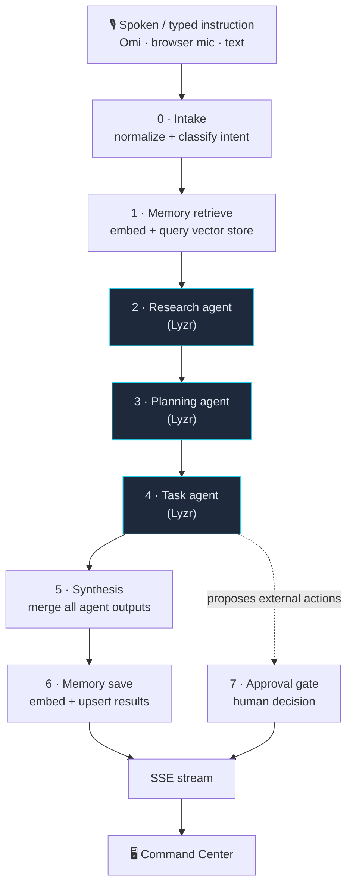

# VoiceFlow AI

> **One spoken instruction becomes a completed multi-agent workflow.**

VoiceFlow AI turns a single spoken (or typed) instruction into an end-to-end, multi-agent
workflow. A **Lyzr** orchestrator delegates to **Research → Planning → Task** agents that
share a **Qdrant** vector-memory store, and a real-time dashboard streams the combined
result. Any external action the agents propose is **queued for human approval — it is never
executed automatically**.

Built for the **Collaborative Multi-Agent Workflows** hackathon.

---

## Highlights

- 🎙️ **One instruction in** — speak it (Omi or browser mic) or type it.
- 🤝 **Orchestrator + 3 specialist agents** — Research, Planning and Task, coordinated end to end.
- 🧠 **Shared vector memory** — results are embedded and stored so **future runs build on past ones**.
- 🔎 **Live SSE timeline** — every step streams into the UI as it happens.
- 🛑 **Human-in-the-loop approval gate** — external actions are held for a decision, never auto-executed.
- 🧪 **Zero-key Demo Mode** — the whole app runs with **no API keys** at all.
- 📊 **Five screens** — Command Center, Task Board, Memory Explorer, History and Approvals.

---

## Architecture



The whole run is **fault-isolated**: every agent call is wrapped in its own `try/catch`, so a
single failing agent emits an `error` step and the workflow continues to completion.

### The pipeline

| # | Step id | Agent | What happens |
|---|---------|-------|--------------|
| 0 | `intake` | orchestrator | Normalizes the transcript and classifies intent; titles the run. |
| 1 | `memory_retrieve` | memory | Embeds the request and queries the vector store for relevant memories. |
| 2 | `research` | research | Investigates the request and returns sourced findings. |
| 3 | `planning` | planning | Builds options, a comparison and a week plan. |
| 4 | `task` | task | Converts the plan into executable tasks + any external actions. |
| 5 | `synthesis` | synthesis | Merges all agent outputs into one final response. |
| 6 | `memory_save` | memory | Embeds and upserts the results so future runs can reuse them. |
| 7 | `approval_gate` | approval | Queues external actions for a human — only if any were proposed. |
| ✓ | `complete` | orchestrator | Emits the final `done` event. |

---

## Tech stack

**Client** — React 18 · Vite 6 · TypeScript · Tailwind CSS v4 (CSS-first `@theme`) ·
framer-motion · lucide-react · class-variance-authority · zustand · @tanstack/react-query ·
sonner · react-router-dom

**Server** — Node · Express 4 · TypeScript · zod · Server-Sent Events · tsx ·
`@qdrant/js-client-rest`

**AI / data** — Lyzr agents (orchestrator + 3 specialists) · Qdrant vector DB ·
OpenAI or a local deterministic embedder · JSON-file persistence

---

## Project structure

```
AiAgent/
├─ client/                       # React dashboard
│  └─ src/
│     ├─ features/
│     │  ├─ command-center/      # live pipeline, timeline, final response
│     │  ├─ tasks/               # Task Board (kanban, drag + keyboard moves)
│     │  ├─ memory/              # Memory Explorer (browse + semantic search)
│     │  ├─ history/             # run history + animated replay
│     │  └─ approvals/           # human-in-the-loop gate
│     ├─ components/             # design system + app shell
│     ├─ hooks/                  # react-query data layer + SSE hook
│     ├─ lib/                    # api client, formatting, helpers
│     ├─ store/                  # zustand stores
│     └─ types/                  # shared client types
├─ server/                       # Express API + agent pipeline
│  └─ src/
│     ├─ agents/                 # orchestrator, research, planning, task, prompts
│     ├─ integrations/           # lyzr, memory (Qdrant), embeddings, omi
│     ├─ routes/                 # voice, runs, memory, tasks, approvals
│     ├─ store/                  # JSON persistence + seed data
│     └─ config/                 # env parsing
├─ .env.example
├─ .gitignore
└─ package.json                  # root convenience scripts
```

---

## Quick start

**Prerequisites:** Node 18+ (20+ recommended) and npm.

```bash
git clone https://github.com/Vinayteja467/VoiceFlow-AI-multi-agent.git
cd VoiceFlow-AI-multi-agent

npm install                 # root (concurrently)
npm install --prefix server
npm install --prefix client
```

Create your env file (optional — **Demo Mode needs no keys**):

```bash
copy .env.example .env      # Windows
cp .env.example .env        # macOS / Linux
```

Run both apps together:

```bash
npm run dev                 # server → http://localhost:8787 , client → http://localhost:5173
```

Then open **http://localhost:5173**.

> The server also **seeds memory on boot** (idempotent). To seed manually: `npm run seed`.

### Demo mode vs live mode

| | Demo Mode | Live Mode |
|---|---|---|
| **When** | automatic when `LYZR_API_KEY` **or** `QDRANT_URL` is missing (or `DEMO_MODE=true`) | both keys present |
| **Agents** | deterministic canned agent outputs | real Lyzr agents |
| **Memory** | in-process + file-backed vector store | **Qdrant** collection |
| **Embeddings** | local deterministic hash embedder (256-d) | OpenAI `text-embedding-3-small` |
| **Pacing** | steps are paced so the demo is watchable | as fast as the model responds |

---

## Environment variables

| Variable | Default | Purpose |
|---|---|---|
| `PORT` | `8787` | Server port |
| `LYZR_API_KEY` | – | Lyzr API key (live mode) |
| `LYZR_ORCHESTRATOR_AGENT_ID` | – | Lyzr orchestrator agent |
| `LYZR_RESEARCH_AGENT_ID` | – | Lyzr research agent |
| `LYZR_PLANNING_AGENT_ID` | – | Lyzr planning agent |
| `LYZR_TASK_AGENT_ID` | – | Lyzr task agent |
| `QDRANT_URL` | – | Qdrant endpoint (live mode) |
| `QDRANT_API_KEY` | – | Qdrant API key |
| `QDRANT_COLLECTION` | `voiceflow_memory` | Collection name |
| `EMBEDDING_PROVIDER` | `local` | `local` or `openai` |
| `OPENAI_API_KEY` | – | Required when `EMBEDDING_PROVIDER=openai` |
| `EMBEDDING_DIM` | `256` | Vector dimension (`1536` for OpenAI) |
| `OMI_WEBHOOK_SECRET` | – | Optional; Omi must send `x-omi-secret` |
| `DEMO_MODE` | auto | Force demo/live |

> 🔒 All API keys live **server-side only** — none are ever exposed to the client.

---

## API reference

| Method | Endpoint | Body / Query | Returns |
|---|---|---|---|
| `GET` | `/api/health` | – | `{ ok, mode: 'demo'\|'live', embeddingProvider, collection, time }` |
| `POST` | `/api/runs` | `{ text (1-2000), source: 'omi'\|'browser'\|'text' }` | `202 { runId }` (422 on invalid) |
| `GET` | `/api/runs` | – | `{ runs: Run[] }` (newest first) |
| `GET` | `/api/runs/:id` | – | `{ run }` |
| `GET` | `/api/runs/:id/stream` | – | **SSE** — `event: step` and `event: done` |
| `GET` | `/api/memory` | – | `{ results, count }` |
| `GET` | `/api/memory/search` | `?q=` | Scored, semantically ranked memories |
| `GET` | `/api/tasks` | `?runId=` | `{ tasks, count }` |
| `PATCH` | `/api/tasks/:id` | `{ status?, priority?, title? }` | Updated task |
| `GET` | `/api/approvals` | – | `{ approvals, pending }` |
| `POST` | `/api/approvals/:id` | `{ action: 'approve'\|'reject', edits? }` | Resolved approval + audit entry |
| `POST` | `/api/voice/omi-webhook` | Omi payload | `{ ok, id, text }` |
| `POST` | `/api/voice/text` | `{ text, source }` | `{ ok, text, source }` |
| `GET` | `/api/voice/omi/latest` | – | Latest Omi transcript |

**SSE contract** — `StepEvent = { runId, step, agent, status, message, payload?, timestamp, durationMs? }`
where `status ∈ queued | running | done | error`. The server sends `retry: 3000` plus `: hb`
heartbeats every 15s, and replays stored events on reconnect.

---

## Screens

| Route | Screen | What it does |
|---|---|---|
| `/` | **Command Center** | Speak/type an instruction, watch the 8-step pipeline stream, read the final response. |
| `/tasks` | **Task Board** | Kanban of generated tasks; drag-and-drop **or** keyboard arrows to move; optimistic updates. |
| `/memory` | **Memory Explorer** | Browse stored memories, filter by type, run semantic search with similarity scores. |
| `/history` | **History** | Every past run, with detail timeline and an animated replay. |
| `/approvals` | **Approvals** | Review queued external actions, inspect payloads, approve (optionally with JSON edits) or reject. |

---

## Omi voice webhook

To drive runs from [Omi](https://omi.me) glasses, the server needs a public URL:

```bash
# expose the API (port 8787)
ngrok http 8787
```

Point Omi's webhook at:

```
POST https://<your-id>.ngrok.app/api/voice/omi-webhook?session_id=<id>&uid=<id>
```

If `OMI_WEBHOOK_SECRET` is set, requests must include header `x-omi-secret: <value>`.
The latest transcript is readable at `GET /api/voice/omi/latest`.

---

## Scripts

| Command (repo root) | Description |
|---|---|
| `npm run dev` | Run server **and** client together |
| `npm run dev:server` | Server only (`tsx watch`, :8787) |
| `npm run dev:client` | Client only (Vite, :5173) |
| `npm run build` | Typecheck server + build client |
| `npm run typecheck` | Typecheck server + client |
| `npm run seed` | Seed demo memory (idempotent) |
| `npm start` | Start the server without watch |

---

## 90-second demo script

1. **Command Center** — pick a suggested prompt (or say *"Plan a 5-day deep-work sprint for our hackathon launch"*).
2. Watch the **8 steps** stream: intake → memory retrieve → research → planning → task → synthesis → memory save → approval gate.
3. Point out the **memory retrieve** hits — proof the agents are grounded in past runs.
4. Open **Memory Explorer** — the results from this run were just saved.
5. Open **Task Board** — drag a task to *In progress*.
6. Open **Approvals** — an external action is pending; **approve** it and show the audit trail (note: nothing was executed).
7. Open **History** — replay the run.

---

## Notes & limitations

- **Nothing auto-executes.** Approving an action records the decision and an audit trail; it does not perform the external side effect. That gate is intentional.
- **Persistence** is a JSON file at `server/data/db.json` (git-ignored). Delete it to reset runs, tasks, approvals and memories.
- **Demo embeddings** are a deterministic local hash (unigrams + bigrams → 256-d, L2-normalized) — great for offline demos, not a substitute for a real model.
- The client bundle is a single chunk (**~499 kB / ~154 kB gzip**); code-splitting is a possible follow-up.

---

## License

Released for the hackathon. Add a `LICENSE` file if you intend to open-source it formally.
